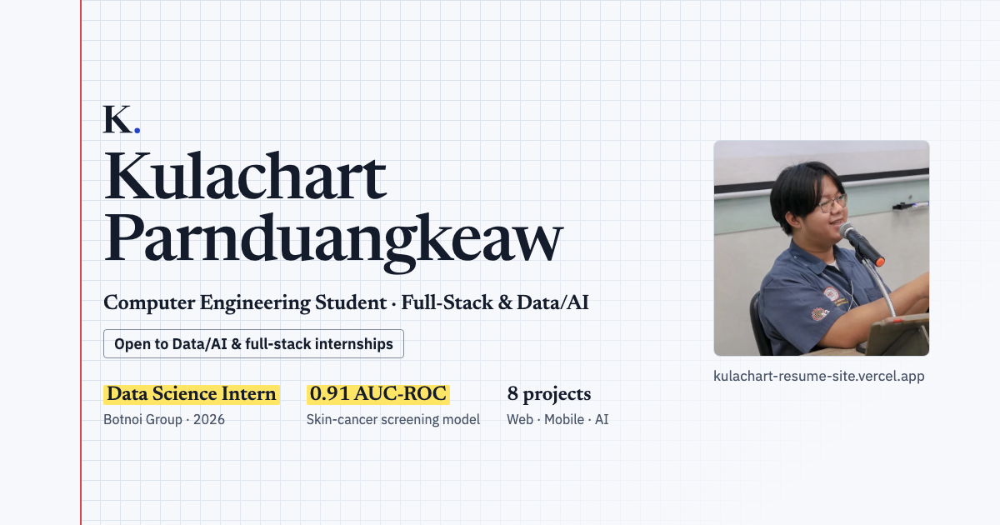

# Kulachart Parnduangkeaw — Portfolio



Personal portfolio and resume of **Kulachart Parnduangkeaw**, a Computer Engineering student at Srinakharinwirot University focused on Data Science & ML and full-stack development.

**Live site:** https://kulachart-resume-site.vercel.app

## Highlights

- **One source of truth.** All content lives in [`src/data.ts`](src/data.ts). The website and the downloadable PDF CV are both generated from it, so they always match.
- **Design system.** A "lab notebook" look built on design tokens in [`src/styles/tokens.css`](src/styles/tokens.css), with light and dark themes. [`DESIGN_SYSTEM.md`](DESIGN_SYSTEM.md) explains every token and the rules for using them.
- **Interactive projects.** Filter projects by technology, or select a skill to jump to the projects that use it.
- **⌘K command palette.** Jump to any section, copy the email, download the CV, or open GitHub/LinkedIn from the keyboard.
- **Accessible.**
  - Semantic landmarks and headings
  - Skip link and visible focus states
  - Screen-reader hints for links that open a new tab
  - WCAG AA contrast in both themes
  - Full `prefers-reduced-motion` support
- **Light on motion.** No text waits on a timed animation. Decorative effects are CSS (scroll-driven where the browser supports it) and only change transform, opacity or drawn strokes, so nothing shifts the layout. Framer Motion loads through `LazyMotion` and only animates the toast and the project filter.
- **Share-ready.** Open Graph and Twitter cards use a generated preview image, plus JSON-LD structured data.

## Tech stack

React 19 · TypeScript · Vite 7 · Tailwind CSS v4 with design tokens · Framer Motion · Newsreader and IBM Plex Sans (self-hosted)

## Getting started

Requires Node.js 22.18 or later, because the generator scripts run TypeScript directly.

```bash
npm install
npm run dev           # http://localhost:5173
npm run build         # type-check + production build into dist/
npm run preview       # serve the production build locally
npm run lint
npm run check:tokens  # find Tailwind default classes that the design tokens turned off
```

Run `check:tokens` after UI changes. `tokens.css` turns off Tailwind's default colors, font sizes, fonts, radii and shadows. Tailwind doesn't report an unknown class; it just generates no CSS for it, so lint and build still pass while the page breaks.

## Updating content

1. Edit [`src/data.ts`](src/data.ts). It holds the profile, projects, experience, skills, and education. Its `TODO` comments mark facts that still need filling in.
2. Regenerate the PDF CV with `npm run cv`. The output is `src/assets/Kulachart-Parnduangkeaw-CV.pdf`, and it must stay on one A4 page.
3. Regenerate the link-preview image with `npm run og` after changing any of these:
   - the name, `focus`, `role`, `school`, `availability` or `siteUrl`
   - the first three `highlights`
   - the profile photo

   The output is `public/og-image.png`.

Both generators render HTML with headless Google Chrome. If Chrome isn't in its default location, set `CHROME_PATH`.

A new skill or project tag also needs an entry in [`src/config/skillFamilies.ts`](src/config/skillFamilies.ts), or it is listed under Tools. To show a logo for it, add one to [`src/config/skillLogos.ts`](src/config/skillLogos.ts).

## Project structure

```
src/
├── data.ts                 # all website + CV content
├── styles/tokens.css       # design tokens: colors, type, spacing, radii, shadow, motion
├── index.css               # base styles and decorative utilities built on the tokens
├── config/
│   ├── sections.ts         # section ids/labels shared by nav, ⌘K palette, and scroll-spy
│   ├── skillFamilies.ts    # skill → family (ML / DL, Data, Full-stack, Languages)
│   └── skillLogos.ts       # brand logo paths from Simple Icons, loaded as a separate chunk
├── sections/               # Hero, Projects, Experience, Skills, Education, Contact
├── components/             # Navbar, CommandPalette, Toast, Section, Logo, SkillLogo, icons, …
├── lib/                    # hooks and helpers: theme, scroll-spy, clipboard, highlighter, …
├── types/                  # type declarations (CSS custom properties in `style`)
└── assets/                 # profile photos and the generated CV
scripts/                    # CV PDF and og:image generators, token check
design/logo/                # source files of the Serif K. logo
DESIGN_SYSTEM.md            # what every token means and how to use it
```

## Deployment

The site is deployed on Vercel with the Vite preset (build command `npm run build`, output `dist/`). Every push to `main` goes live.
