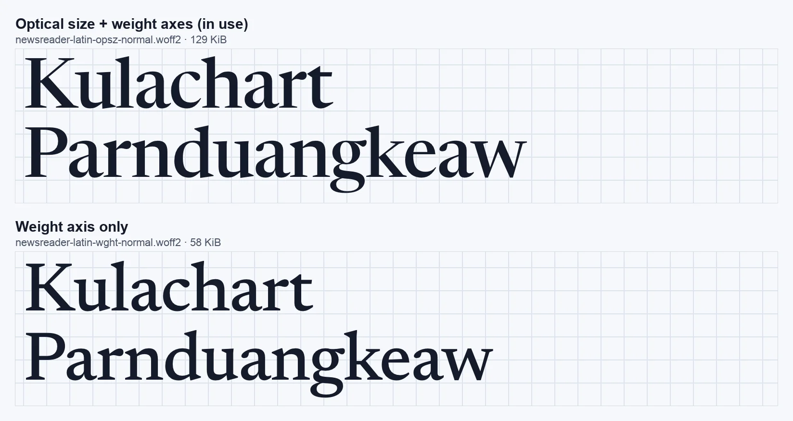
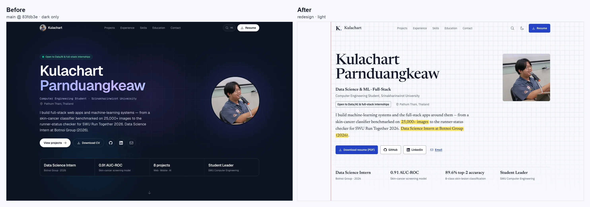
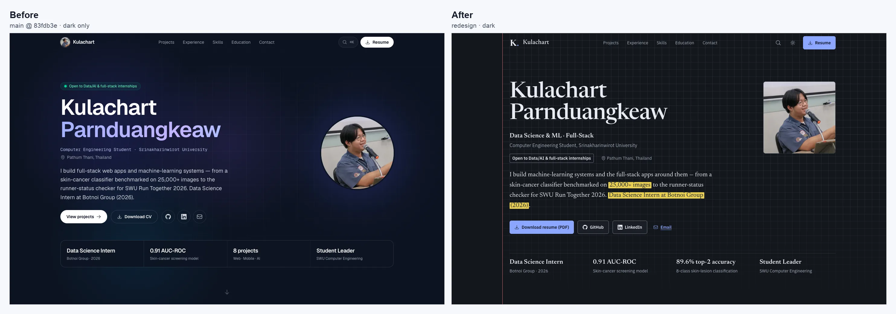
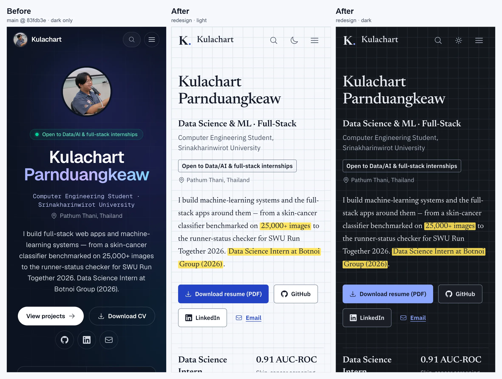
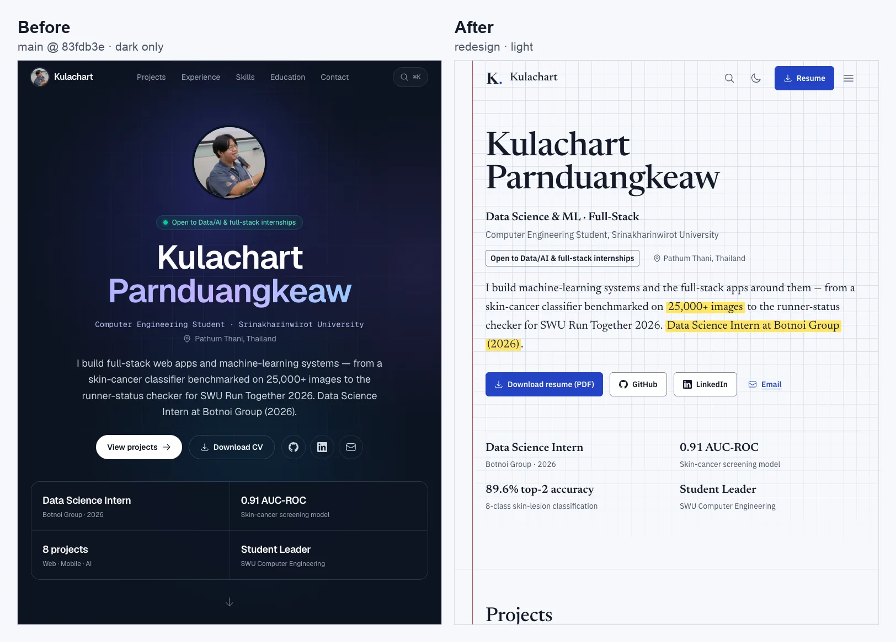
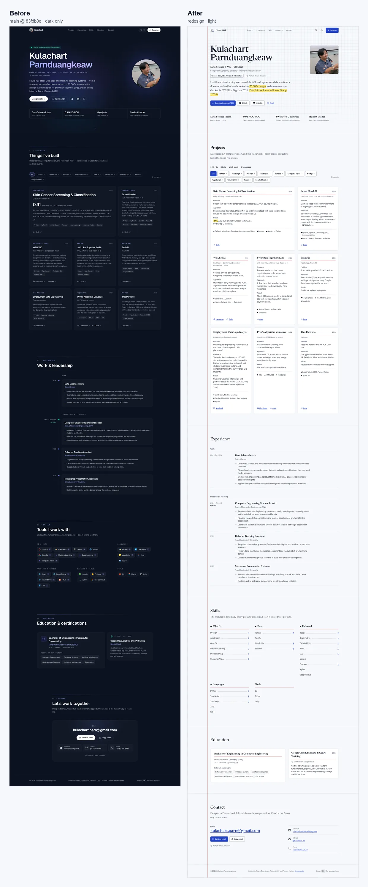
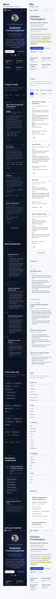

# Phase 4 · ผลก่อนและหลัง redesign

เทียบเว็บเดิม (`main` ที่ commit `83fdb3e` ก่อนเริ่ม redesign) กับ branch `redesign` หลังจบ Phase 4 ด้วยเครื่องมือและเงื่อนไขเดียวกันทุกอย่าง

## สรุปสั้น

- **Accessibility 93 → 100** ทั้ง mobile และ desktop และ axe ไม่เจอปัญหาเลยทั้งโหมดสว่างและมืด (เดิมข้อความสีเทาไม่ผ่าน contrast 9–12 จุด)
- **Best Practices และ SEO ได้ 100 เท่าเดิม**
- **Performance: desktop 100 เท่าเดิม ส่วน mobile 98 → 95** เพราะฟอนต์ serif ที่เป็นเสียงของเว็บหนักกว่าเดิม 122 KiB ระหว่างวัดเจอ layout shift จากฟอนต์ที่หลุดมาจาก Phase 3 และแก้ใน phase นี้แล้ว
- **Hero ตอบ "ใคร ทำอะไร หางานอะไร" ในจอแรก** ชื่อขึ้นมาอยู่ที่ 14% ของความสูงจอมือถือ (เดิม 35%) และมีบรรทัด "Data Science & ML · Full-Stack" ใต้ชื่อทันที
- **ระบบเรียบขึ้น** ข้อความเล็กกว่า 12px จาก 62 จุดเหลือ 0, ขนาดตัวอักษรจาก 9 เหลือ 6 ค่า, สีข้อความจาก 11 เหลือ 4 ค่า และปุ่มบนมือถือที่เล็กกว่า 44px จาก 37 เหลือ 5 ชิ้น

## วิธีวัด

- **Before** = `83fdb3e` (โค้ดเดียวกับเว็บที่ deploy อยู่ตอนนี้) **After** = branch `redesign` ที่ commit ของ Phase 4
- build แบบ production ทั้งคู่ แล้วเสิร์ฟจากเครื่องเดียวกันด้วย static server ตัวเดียวกันที่ทำตัวเหมือน Vercel: บีบอัด brotli และตอบ 404 เมื่อไม่มีไฟล์
- **Lighthouse 12.6.0** บน Chrome 156 แบบ headless รันแบบละ 3 รอบแล้วใช้รอบที่ Performance อยู่ตรงกลาง
  - **Mobile** คือค่าเริ่มต้นของ Lighthouse: จอ 412×823, CPU ช้าลง 4 เท่า และจำลองเน็ต slow 4G (RTT 150ms, 1.6 Mbps)
  - **Desktop** คือ `--preset=desktop`
- **ภาพหน้าจอ** ถ่ายด้วย Playwright ที่ 375px (2x), 768px และ 1440px ก่อนถ่ายทั้งหน้าจะเลื่อนลงจนสุด เพื่อให้ animation ที่รอการเลื่อนเล่นครบ
- **ค่าอื่น** (axe, ขนาดตัวอักษร, ขนาดเป้ากด, ตำแหน่ง h1) วัดด้วยสคริปต์เดียวกันทั้งสองเวอร์ชัน
- ตัวเลขนี้วัดบนเครื่องเรา ใช้เทียบกันเองได้ แต่ไม่ใช่ตัวเลขของ Vercel จริง

> ใน Phase 0 เว็บเดิมได้ SEO 92 เพราะ `vite preview` ตอบ `/robots.txt` เป็นหน้า HTML ครั้งนี้ server ตอบ 404 เหมือน Vercel จึงได้ 100 ทั้งคู่

## Lighthouse

| หมวด | Mobile ก่อน | Mobile หลัง | Desktop ก่อน | Desktop หลัง |
|---|---|---|---|---|
| Performance | 98 | **95** | 100 | **100** |
| Accessibility | 93 | **100** | 93 | **100** |
| Best Practices | 100 | **100** | 100 | **100** |
| SEO | 100 | **100** | 100 | **100** |

| ค่าวัด | Mobile ก่อน | Mobile หลัง | Desktop ก่อน | Desktop หลัง |
|---|---|---|---|---|
| First Contentful Paint | 1.8 s | 1.8 s | 0.4 s | 0.4 s |
| Largest Contentful Paint | 2.1 s | 2.8 s | 0.5 s | 0.6 s |
| Total Blocking Time | 0 ms | 0 ms | 0 ms | 0 ms |
| Cumulative Layout Shift | 0 | 0 | 0 | 0 |
| Speed Index | 1.8 s | 1.8 s | 0.6 s | 0.4 s |
| ขนาดที่โหลดทั้งหมด | 182 KiB | 270 KiB | 182 KiB | 280 KiB |

### ทำไม Accessibility ขึ้นเป็น 100

- **เดิม** ข้อความรองใช้ `gray-500` (#6a7282) บนพื้น navy ได้ contrast แค่ 3.7–3.9:1 แต่ WCAG ขอ 4.5:1 และลิงก์ "Source code" ใน footer ต่างจากข้อความรอบข้างแค่สี (1.76:1)
- **ตอนนี้** ทุกสีมาจาก token ที่ตรวจ contrast ไว้แล้วในทั้งสองโหมด เช่น `ink-muted` ได้ 7.1–7.5:1 และลิงก์ทุกตัวมีขีดเส้นใต้ สีจึงไม่ใช่ช่องทางเดียวที่บอกว่ากดได้

### ทำไม Performance บนมือถือลดจาก 98 เป็น 95

ส่วนที่หนักขึ้นคือฟอนต์ ส่วนโค้ดเบาลง:

| ไฟล์ | ก่อน | หลัง |
|---|---|---|
| JavaScript | 98.9 KiB | 87.0 KiB |
| CSS | 8.2 KiB | 6.7 KiB |
| ฟอนต์ | 51.7 KiB (Geist + Geist Mono) | 174.0 KiB (Newsreader 129.1 + IBM Plex Sans 44.9) |
| รูปโปรไฟล์บนมือถือ | 9.6 KiB | ไม่โหลด (รูปแสดงเฉพาะจอ 1024px ขึ้นไป) |
| favicon | 8.0 KiB (รูปถ่าย PNG) | 0.9 KiB (SVG) |

Lighthouse มือถือจำลองเน็ตช้า ฟอนต์ที่ใหญ่ขึ้นจึงทำให้ LCP แบบจำลองเพิ่มจาก 2.1 เป็น 2.8 วินาที (LCP คือย่อหน้า summary ใน hero) ส่วน LCP ที่วัดจริงบนเครื่องนี้แบบไม่จำลองความช้ากลับเร็วขึ้นจาก 1.26 เหลือ 0.45 วินาที เพราะเว็บเดิมให้ข้อความใน hero ค่อยๆ fade เข้ามา

**ลองฟอนต์ที่เบากว่าแล้ว** DESIGN_SYSTEM.md วางแผนไว้ตั้งแต่ Phase 1 ว่าถ้า performance ลดให้เปลี่ยน Newsreader เป็นแบบน้ำหนักอย่างเดียว (58 KiB แทน 129 KiB) ผลที่วัดได้:
- คะแนน mobile ของแบบน้ำหนักอย่างเดียวแกว่ง 93–98 (ค่ากลาง 96)
- แบบที่ใช้อยู่ได้ 95 ทั้ง 3 รอบ
- ต่างกันไม่ชัดเกินค่าแกว่ง แต่ชื่อใน hero เสียรูปตัวแบบ display ไปอย่างเห็นได้

จึงคงแบบมีแกน optical size ไว้:



แถวบนเป็นรูปตัวที่ออกแบบมาสำหรับ 72px: เส้นหนาบางต่างกันมากขึ้น ตัวชิดกันขึ้น และ x-height สูงขึ้น ส่วนแถวล่างเป็นรูปตัวสำหรับเนื้อความที่ถูกขยายขึ้นมา ซึ่งดูบางและหลวมเมื่อใหญ่ขนาดนี้ หลักการนี้คือ **optical sizing**: ตัวอักษรขนาดต่างกันควรมีรูปทรงต่างกัน ไม่ใช่แค่ย่อหรือขยายรูปเดียว

### Layout shift ที่เจอและแก้ใน phase นี้

เวอร์ชันที่จบ Phase 3 ได้ Performance 91 ทั้ง mobile และ desktop สาเหตุคือ CLS 0.12 บนมือถือและ 0.20 บน desktop:
1. ข้อความถูกวาดด้วยฟอนต์สำรองก่อน
2. พอ Newsreader กับ Plex โหลดเสร็จ summary ก็ตัดบรรทัดใหม่
3. ปุ่มและแถวตัวเลขข้างล่างจึงถูกดันลง ซึ่งผู้ใช้รู้สึกได้ว่าหน้ากระตุกตอนกำลังจะกด

แก้ 3 จุด:

| ไฟล์ | แก้อะไร | ทำไม |
|---|---|---|
| `src/styles/tokens.css` | ฟอนต์สำรอง "Newsreader Fallback" กับ "IBM Plex Sans Fallback" ที่ปรับ Georgia กับ Arial ด้วย `size-adjust` ให้กว้างเท่าฟอนต์จริง | คำนวณจากความกว้างเฉลี่ยของข้อความทั้งหมดใน `data.ts` บรรทัดจึงตัดที่จุดเดิมแม้ฟอนต์จริงยังไม่มา |
| `vite.config.ts` | plugin เล็กๆ ที่ใส่ `<link rel="preload">` ให้ไฟล์ฟอนต์ latin สองไฟล์ | เว็บเป็น SPA ถ้าไม่บอกก่อน เบราว์เซอร์จะรู้ว่าต้องใช้ฟอนต์ก็ต่อเมื่อ React วาดข้อความแล้ว |
| `src/sections/HeroSection.tsx` | รูปโปรไฟล์ใช้ `<picture>` ที่เลือกรูปจริงเฉพาะจอ 1024px ขึ้นไป | `` ที่ซ่อนด้วย CSS ยังถูกโหลดเสมอ และใน Phase 3 ยังตั้ง priority สูงไว้ด้วย จึงแย่ง bandwidth กับ JS และฟอนต์บนมือถือ |

ทางเลือกที่ลองวัดก่อนตัดสินใจ (ทุกแบบรวมการแก้รูปโปรไฟล์แล้ว แบบที่ใช้รัน 3 รอบ แบบอื่นรันแบบละรอบเดียว):

| แบบ | Mobile | Desktop |
|---|---|---|
| จบ Phase 3 (ยังไม่แก้) | 91 (CLS 0.12) | 91 (CLS 0.20) |
| ฟอนต์สำรองอย่างเดียว ไม่ preload | 95 | 96 (CLS 0.13) |
| ฟอนต์สำรอง + preload Newsreader | 94 | 100 |
| **ฟอนต์สำรอง + preload ทั้งสองฟอนต์ (ที่ใช้)** | **95** | **100** |

## ภาพก่อนและหลัง

### จอแรกบน desktop: สิ่งที่ recruiter เห็นใน 5 วินาที





### จอแรกบนมือถือและ tablet





### ทั้งหน้า

ย่อให้เห็นโครงสร้าง ไม่ได้ตั้งใจให้อ่านตัวหนังสือ





## ค่าที่วัดได้อื่นๆ

| ค่า | ก่อน | หลัง |
|---|---|---|
| ปัญหาจาก axe (WCAG 2.2 AA + best practice) | 2 กฎ: contrast 9–12 จุด, ลิงก์ที่ต่างแค่สี 1 จุด | 0 ทุกความกว้าง ทั้งสองโหมด |
| ข้อความเล็กกว่า 12px | 47 จุด (มือถือ), 62 จุด (tablet/desktop) | 0 |
| ขนาดตัวอักษรที่ใช้จริง (desktop) | 9 ค่า | 6 ค่า |
| สีข้อความที่ใช้จริง (desktop) | 11 ค่า | 4 ค่า (สว่าง), 5 ค่า (มืด) |
| ความโค้งมุม | 7 ค่า (4–24px และแบบแคปซูล) | 3 ค่าจาก token (4, 6, 8px) และ 2px ของแถบปากกาเน้น |
| ฟอนต์ | Geist + Geist Mono | Newsreader + IBM Plex Sans |
| ปุ่ม/ลิงก์บนมือถือที่เล็กกว่า 44px | 37 จาก 50 ชิ้น | 5 จาก 54 ชิ้น |
| ปุ่ม/ลิงก์บนมือถือที่เล็กกว่า 24px | 8 ชิ้น | 3 ชิ้น (ชื่อการ์ด ซึ่งจริงๆ กดได้ทั้งการ์ด) |
| ตำแหน่งบนของชื่อ (h1) จากความสูงจอ | 35% / 32% / 23% | 14% / 13% / 18% |
| ความยาวหน้า (จำนวนจอ) | 11.2 / 7.5 / 7.1 | 11.4 / 8.3 / 7.9 |
| Skills เริ่มที่จอที่ | 6.9 / 4.9 / 4.5 | 7.0 / 5.4 / 5.3 |
| JS / CSS หลัง gzip | 116 KB / 9.4 KB | 102 KB / 7.6 KB |

(ค่าที่มีสามตัวเรียงเป็น มือถือ 375 / tablet 768 / desktop 1440 ส่วนปุ่มและลิงก์ไม่นับลิงก์ที่อยู่ในย่อหน้า เพราะ WCAG ยกเว้นให้)

ปุ่มบนมือถือ 5 ชิ้นที่ยังเล็กกว่า 44px:
- logo กับชื่อใน navbar สูง 32px
- อีเมลในหัวข้อ Contact สูง 32px
- ลิงก์ชื่อการ์ด 3 ใบสูง 21px แต่เป็น stretched link ที่คลุมทั้งการ์ด เป้ากดจริงจึงคือการ์ดทั้งใบ

ทั้งหมดผ่านเกณฑ์ขั้นต่ำ 24px ของ WCAG 2.2 AA (ข้อ 2.5.8) และ axe ไม่เตือน

## สิ่งที่เปลี่ยนและเหตุผล

ชื่อหลักการ UX/UI อยู่ในวงเล็บ ใช้ค้นต่อได้

### 1. ทิศทางภาพรวม: จาก "AI template สีมืด" เป็น "สมุดบันทึกการทดลอง"

- **ก่อน** พื้น navy, gradient indigo/violet/sky, blob ลอย, วงแหวนหมุน, ฟอนต์ Geist กับ mono และไม่มี logo ทั้งหมดนี้คือหน้าตาของ template portfolio สาย AI ที่ recruiter เห็นบ่อยที่สุด
- **หลัง** กระดาษกราฟ เส้น margin สีแดง บัตรคำ หมึกน้ำเงินดำ และปากกาเน้นข้อความ
- **เหตุผล** งาน Data Science เกิดใน notebook และจบด้วยรายงานผลที่มีหลักฐาน ภาษาภาพของ "เอกสารที่วัดผลได้" จึงบอกนิสัยการทำงานแทนคำโฆษณา และทำให้จำได้ในหมู่ portfolio ที่หน้าตาเหมือนกัน (**differentiation**, **Von Restorff effect**: ของที่ต่างจากกลุ่มถูกจำได้มากกว่า)

### 2. Hero: ผ่าน 5-second test

- **ก่อน**
  - รูปวงกลมอยู่บนสุดของมือถือ ดันชื่อลงไปที่ 35% ของจอ
  - ตำแหน่งเขียนด้วย monospace ตัวเล็ก
  - ใต้ชื่อไม่มีบรรทัดที่บอกสายงาน คำว่า Data/AI อยู่ในป้ายเล็กเหนือชื่อกับใน summary
  - ปุ่มหลักคือ "View projects"
  - GitHub, LinkedIn, Email เป็นไอคอนเปล่า
  - ช่องตัวเลขหนึ่งช่องคือ "8 projects"
- **หลัง** ลำดับการอ่านคือ:
  1. ชื่อ
  2. สายงาน "Data Science & ML · Full-Stack"
  3. สถานะนักศึกษาและมหาวิทยาลัย
  4. ป้าย "Open to Data/AI & full-stack internships"
  5. summary ที่ขีดปากกาเน้นที่หลักฐาน 2 จุด
  6. ปุ่ม "Download resume (PDF)" เป็นปุ่มหลักปุ่มเดียว
  7. ปุ่มรองที่มีชื่อกำกับ
  8. ตัวเลขที่เป็นผลงานจริง (0.91 AUC-ROC, 89.6% top-2 accuracy)
- **เหตุผล**
  - recruiter มีเวลาราว 30 วินาที และอ่านแบบสแกนจากบนซ้าย สิ่งที่ต้องรู้จึงต้องเรียงตามลำดับที่ตาไปถึง (**visual hierarchy**, **F-pattern**)
  - ปุ่มหลักมีปุ่มเดียวเพื่อให้ไม่ต้องเลือก (**Hick's law**)
  - ไอคอนเปล่าต้องเดาความหมาย ส่วนป้ายชื่อให้อ่านได้ทันที (**recognition over recall**)
  - "8 projects" บอกปริมาณ แต่ตัวเลข accuracy บอกคุณภาพ

### 3. การ์ดโปรเจกต์: จากคำอธิบายเป็น Problem → Approach → Result

- **ก่อน** ย่อหน้าคำอธิบายกับ tag ตัว mono เล็กๆ มีตัวเลขผลลัพธ์แค่ 1 ใน 8 โปรเจกต์
- **หลัง**
  - บัตรคำที่มีเส้นแดงใต้ชื่อ แบ่งเป็นช่อง Problem / Approach / Result
  - ผลลัพธ์ขีดด้วยปากกาเน้น
  - tag เรียงตามหมวดและกำกับด้วยรูปทรง ● ■ ▲ ◆
  - กดได้ทั้งการ์ด
- **เหตุผล**
  - ทุกการ์ดเรียงข้อมูลแบบเดียวกัน ตาจึงรู้ว่าจะหาผลลัพธ์ตรงไหน และโครงนี้ใกล้กับ STAR ที่ใช้ในการสัมภาษณ์งาน (**chunking**, **consistency**)
  - รูปทรงที่ใช้คือ marker ของ matplotlib: บอกหมวดได้โดยไม่ใช้สี คนตาบอดสีและการพิมพ์ขาวดำจึงแยกได้ และสื่อว่าคุ้นกับ data viz (**redundant coding**, WCAG 1.4.1)
  - การ์ดทั้งใบเป็นเป้ากดที่ใหญ่กว่าลิงก์ชื่อมาก (**Fitts's law**)

### 4. Skills: จากไอคอนเป็นดัชนีท้ายเล่ม

- **ก่อน** chip ไอคอนโลโก้พร้อมตัวเลขเล็กๆ จัดกลุ่มตามชนิดเครื่องมือ (AI & Data, Languages, Frontend & Mobile, Backend & Cloud, Tools)
- **หลัง**
  - รายการแบบดัชนีท้ายหนังสือ: ชื่อ ....... จำนวนโปรเจกต์ที่ใช้ ในตำแหน่งเลขหน้า
  - จัดกลุ่มตามสายงานเป็น ML / DL, Data, Full-stack, Languages, Tools
  - ทั้งแถวเป็นปุ่มสูง 44px กดแล้วกรองโปรเจกต์ให้ (ฟีเจอร์เดิมที่เก็บไว้)
- **เหตุผล**
  - recruiter สาย DS มองหา ML กับ Data ก่อน กลุ่มที่ตั้งตามสายงานจึงตอบคำถามของเขาตรงกว่ากลุ่มตามชนิดเครื่องมือ
  - จำนวนโปรเจกต์เป็นหลักฐานที่ตรวจได้ ต่างจากแถบ % ที่ไม่มีหน่วยวัดจริง (React 80% ไม่มีความหมาย) (**evidence over claims**)
  - ไอคอนโลโก้หลายสิบอันแข่งกันดึงสายตา และทำให้หน้าดูเหมือน template

### 5. ตัวอักษร

- **ก่อน** Geist กับ Geist Mono ใช้ 9 ขนาด มีข้อความ 11px 62 จุด และใช้ monospace เป็นของตกแต่ง
- **หลัง**
  - Newsreader (serif) เป็น "เสียง" ของชื่อ หัวข้อ และ summary ส่วน IBM Plex Sans "ทำงาน" ในเนื้อหา ปุ่ม และ tag
  - ขนาดมาจาก classic scale ของ Bringhurst
  - ไม่มีอะไรเล็กกว่า 12px และบรรทัดยาวไม่เกิน 66 ตัวอักษร
- **เหตุผล**
  - สองฟอนต์ที่บทบาทไม่ซ้อนกันทำให้รู้ทันทีว่าอะไรคือหัวข้อ อะไรคือข้อมูล (**typographic hierarchy**)
  - บรรทัดที่ยาวเกิน 75 ตัว ตาจะหาต้นบรรทัดถัดไปยาก (**line length / measure**)

### 6. สี

- **ก่อน**
  - ค่าสีดิบ 42 ค่า (indigo, violet, sky, emerald และ white แบบโปร่งใส 16 ระดับ)
  - มีแต่โหมดมืด
  - ข้อความรองสีเทาไม่ผ่าน contrast
- **หลัง**
  - token ตามความหมาย 14 ตัว แต่ละตัวมีค่าทั้งโหมดสว่างและมืด และทุกคู่ผ่าน WCAG AA
  - โหมดเริ่มต้นตามที่ตั้งไว้ในระบบของผู้ใช้ และมีปุ่มสลับ
- **เหตุผล**
  - ตั้งชื่อสีตามหน้าที่ (`pen` = กดได้, `marker` = หลักฐาน) ทำให้สีมีความหมายเดียวทั้งเว็บ ผู้ใช้จึงเรียนรู้ครั้งเดียว (**semantic color**, **affordance**)
  - ผู้ใช้เลือกโหมดเองได้ แทนที่เว็บจะบังคับโหมดมืด (**user control**)

### 7. ระยะห่างและ layout

- **ก่อน** ความกว้าง container สลับ 3 ค่า และ padding การ์ด 5 ค่าที่ต่างกันนิดเดียว
- **หลัง**
  - container เดียว 1200px
  - ระยะห่าง 10 ขั้น
  - เส้น margin สีแดงทำให้ขอบซ้ายของทุก section ตรงกัน
  - กระดาษกราฟอยู่หลัง hero เท่านั้น
- **เหตุผล**
  - ระยะที่ต่างกันนิดเดียว ตาเห็นว่า "ไม่ตรง" แต่บอกไม่ได้ว่าทำไม ขั้นที่ห่างกันชัดทำให้ทุกระยะดูตั้งใจ (**alignment**, **rhythm**)
  - ของที่เกี่ยวกันอยู่ใกล้กัน ของคนละเรื่องห่างกัน (**Gestalt: proximity**)

### 8. Motion

- **ก่อน** blob ลอย วงแหวนหมุน จุด ping และลูกศร bounce เล่นตลอดเวลา ข้อความใน hero fade เข้ามาทีละบรรทัด และทุก section fade-in เมื่อเลื่อนมาถึง
- **หลัง**
  - มี sequence เดียวตอนโหลด: ปากกาเน้นขีดผ่านหลักฐานใน hero
  - ผลลัพธ์บนการ์ดถูกขีดครั้งแรกที่เลื่อนมาเห็น
  - ผู้ที่ตั้ง reduce motion จะเห็นสถานะสุดท้ายทันที
- **เหตุผล**
  - สิ่งที่ขยับดึงสายตาเสมอ จึงควรใช้กับสิ่งเดียวที่อยากให้เห็นก่อน คือหลักฐาน (**motion as attention**)
  - loop ที่เล่นตลอดแย่งความสนใจจากเนื้อหา และ WCAG 2.2.2 ขอให้หยุดได้สำหรับสิ่งที่ขยับนานเกิน 5 วินาที
  - ข้อความที่ fade เข้ามาทำให้อ่านได้ช้าลง (LCP ที่วัดจริงของเว็บเดิมจึงช้ากว่า FCP ถึง 0.7 วินาที)

### 9. Accessibility

สิ่งที่เพิ่ม:
- **เป้ากด** สิ่งที่กดได้สูงอย่างน้อย 44px (เดิมปุ่ม Menu 36px และลิงก์ในการ์ด 20px)
- **Contrast** ทุกคู่สีผ่านในทั้งสองโหมด และลิงก์ทุกตัวมีขีดเส้นใต้
- **ตัวอักษร** เล็กสุด 12px
- **อีเมล** ไม่ตัดกลางคำบนมือถืออีกแล้ว (เดิมขึ้นเป็น "gmail.co / m")
- **ปุ่มสลับธีม** มี `aria-pressed` บอกสถานะ
- **สัญลักษณ์หมวด** รูปทรงถูกซ่อนจาก screen reader และอ่านเป็นชื่อหมวดแทน

สิ่งที่เดิมมีอยู่แล้วและรักษาไว้: skip link, focus ring, การปิด animation ตาม reduced motion, และการบอก screen reader ว่าลิงก์เปิดแท็บใหม่

หลักการ: **accessibility is usability** ทุกข้อนี้ช่วยคนทั่วไปด้วย เช่นคนที่กดด้วยนิ้วโป้งบนรถไฟ หรือเปิดเว็บกลางแดด

### 10. ตัวตน

- **ก่อน** ไม่มี logo และ favicon เป็นรูปถ่ายย่อเหลือ 64px
- **หลัง**
  - logo Serif K. ที่มี favicon วาดใหม่สำหรับ 16px
  - รูป link preview (OG) วาดใหม่ในสไตล์เดียวกัน
  - CV PDF ยังสร้างจาก `data.ts` ไฟล์เดียวกับเว็บ เนื้อหาจึงตรงกันเสมอ
- **เหตุผล** ทุกจุดที่ recruiter เจอ (แท็บเบราว์เซอร์, ลิงก์ที่แชร์ใน LINE/LinkedIn, ไฟล์ PDF) ควรบอกว่าเป็นคนเดียวกัน (**consistency across touchpoints**)

### สิ่งที่เก็บไว้จากเว็บเดิม

ทั้งหมดนี้ทำงานดีอยู่แล้วตาม audit ใน Phase 0:
- `data.ts` เป็นแหล่งเนื้อหาเดียว
- การกรองโปรเจกต์จาก skill
- ⌘K command palette
- มือถือแสดงโปรเจกต์ 4 อันแรกพร้อมปุ่ม "Show all" (**progressive disclosure**)
- performance ที่ดี
- พื้นฐาน accessibility ในข้อ 9

## สิ่งที่ยังทำต่อได้

- **เว็บจริงยังเป็นเวอร์ชันเดิม** Vercel deploy จาก `main` ต้อง merge `redesign` เข้า `main` ก่อน แล้วรัน Lighthouse กับเว็บจริงอีกครั้ง:

  ```bash
  npx lighthouse https://kulachart-resume-site.vercel.app --view
  ```

- **ตัวเลขงานที่ Botnoi** ใส่ใน bullet ได้เมื่อเปิดเผยได้
- **หน้ายาวขึ้นราว 10%** (desktop 7.1 → 7.9 จอ) เพราะการ์ดมีสามช่อง ถ้ามีคนบอกว่ายาว ให้ย่อ bullet ใน Experience ก่อน
- **ถ้าอยากได้คะแนน mobile สูงสุด** เปลี่ยน Newsreader เป็นแบบน้ำหนักอย่างเดียวได้ แลกกับรูปตัวของชื่อใน hero (ภาพเทียบอยู่ด้านบน)
- **ถ้าเปลี่ยนฟอนต์** ต้องคำนวณ `size-adjust` ของฟอนต์สำรองใน `tokens.css` ใหม่ และแก้ชื่อไฟล์ใน `preloadFonts` ของ `vite.config.ts`
- **ข้อระดับต่ำจาก audit ที่ยังไม่ได้ทำ**
  - ชื่อการ์ดใน h3 ยังมีคำว่า "(opens in a new tab)" ต่อท้าย ทำให้รายการ heading ใน screen reader ยาว
  - เว็บยังไม่มี `robots.txt` และ `sitemap.xml` (ไม่กระทบคะแนน แต่ช่วย search engine)
